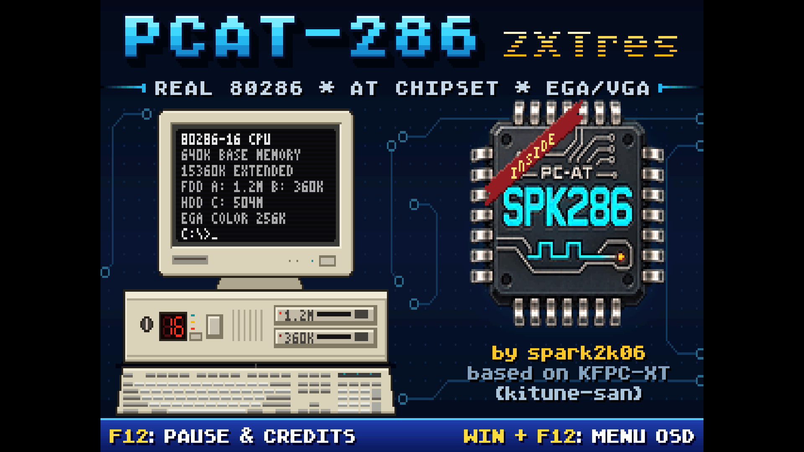

# PCAT-286 for ZXTRES+ and ZXTRES++



PCAT-286 for the ZXTRES+ and ZXTRES++ is an Intel 80286-compatible PC/AT for
the boards' Xilinx Artix-7: the XC7A100T of the ZXTRES+ and the XC7A200T of the
ZXTRES++, which are otherwise the same board. There is one build for each FPGA,
and a file for one does not load on the other. The plain ZXTRES, with a smaller
FPGA, is not supported. The machine is the one of the
[MiSTer core](https://github.com/MiSTer-devel/PCAT-286_MiSTer): the
[SPK286](https://github.com/spark2k06/SPK286) CPU, the AT interrupt, DMA and
timer controllers, the 8042 keyboard controller, CMOS, floppy and IDE storage,
a serial mouse, a gameport, an EGA video subsystem with the VGA 13h+
extension, and the Sound Blaster, OPL2, C/MS and Tandy audio devices. Only
the logic around the machine is specific to this board: the DeMiSTify
controller and OSD, the SDRAM, the SD card, the video output and the audio
output. A fix in the machine reaches both builds.

The core is loaded from the microSD card as a `.ZX3` file, with the NMI
browser of the ZX Spectrum core. It does not replace the installed cores.

The machine description, the memory map, the I/O ports and the CPU
documentation are in the [main README](../README.md), which applies here as
well, except where the table [below](#what-the-board-does-not-have) says
otherwise.

## What works

Evidence levels: **Board** means it was observed on a ZXTRES+ (no ZXTRES++ has run it yet), **Sim** means
it passes in the board simulation in `sim/`, **Built** means it meets timing
in Vivado. The dates are those of the observation in [SPEC.md](SPEC.md).

| Feature | State |
| --- | --- |
| BIOS boot from `PCAT286.ROM` and `EGA.ROM` on the card, or any two BIOS files chosen in the OSD | Board (27 October 2026): the BIOS boots DOS from the hard disk image |
| Hard disks 0 and 1 from `VHD`/`IMG` images | Board (27 October 2026): DOS boots, the second disk is D:, files survive a power cycle. Read speed not recorded. |
| Floppy drives A and B from `IMG`/`IMA`/`VFD` images, 160K to 2.88M, with write protect | Board (27 October 2026). Speed not recorded. |
| CMOS kept in `PCAT286.CMS` on the card | Board (27 October 2026): the configuration survives a power cycle |
| Video: 200-line CGA/EGA modes and VGA 13h doubled to 31 kHz 480p | Board (27 October 2026) |
| Video: 350-line EGA and MDA converted to 720x480 at 59.94 Hz | Board (26 October 2026) |
| Video: 480i and 240p at 15.7 kHz for a TV, CRT H and V offsets | Built, Sim. Not verified on a TV. |
| Audio on the 3.5 mm jack (sigma-delta and I2S): speaker, OPL2, Sound Blaster, C/MS, Tandy | Board (28 October 2026). The source tried was not recorded. |
| PS/2 keyboard, with the OSD opened and closed | Built, Sim |
| PS/2 mouse as a Microsoft serial mouse on COM1 (3F8h, IRQ4) | Board (November 2026). |
| DB9 joysticks on the gameport (digital mode) | Built. Not tested on a board. |
| Installed RAM 1, 2, 4, 8 or 16 MB in the board SDRAM | Built, Sim |
| CPU speed profiles, MAX to 25 MHz (MAX runs at 50 MHz and closes timing) | Built. Only MAX was run on a board. |
| Boot splash, F12 pause and credits | Built, Sim |
| OSD with settings saved to the card | Built, Sim |

Neither this list nor the main README certifies the machine as a complete
AT chipset or its timing as historical; see the qualification limits in the
main README. Nothing here has been reported from games or from protected-mode
software on the board beyond the rows above.

## What the board does not have

| MiSTer feature | On the ZXTRES+ |
| --- | --- |
| AT RAM in the HPS DDR3 | The 64 MiB SDRAM holds the AT RAM. There is no HPS. |
| MiSTer scaler, HDMI, aspect ratio, HQ2x | VGA output at 480p, or at 15.7 kHz; the OSD offers the options in the Video page. DisplayPort is not implemented yet. |
| COM2, MIDI and MT32-pi on the user port | The board has no user port, so there is no COM2 or MIDI. |
| Second SD card as an IDE disk | The one microSD slot belongs to the controller. |
| Real-time clock from the HPS | The board has none. Set the time in DOS or in the BIOS setup; the CMOS file keeps the rest. |
| Analog joysticks | The DB9 ports give directions and buttons only. |
| Return to the Spectrum core from the OSD | Power cycle the board. |
| Image files created by the core | The controller can write a file but not create one: `PCAT286.CMS` and `PCAT286.CFG` must exist, see below. |

## Preparing the microSD card

The core looks for its files in a folder `PCAT286` at the root of the card,
or in the root when there is no such folder.

| File | What it is |
| --- | --- |
| `PCAT286.ROM` | The system BIOS, at most 32 KiB. The [BIOS Builder](https://aitorgomez-net.github.io/PCAT-286_ZXTres/BIOS_Builder) prepares it, and the EGA ROM. |
| `EGA.ROM` | The EGA BIOS, at most 32 KiB. |
| `PCAT286.CMS` | 512 bytes of zeroes, made once. The core fills it with the CMOS contents. |
| `PCAT286.CFG` | 512 bytes of zeroes, made once. Written by *Save settings* in the OSD; zeroes mean default settings. |
| Disk and floppy images | Anywhere on the card, chosen in the OSD. Hard disks are `.VHD` or `.IMG`, floppies `.IMG`, `.IMA` or `.VFD`. |

The [configuration generator](https://aitorgomez-net.github.io/PCAT-286_ZXTres/CFG_Generator/)
(source: [docs/CFG_Generator.html](../docs/CFG_Generator.html), it also
works offline) is a stand-alone page that writes `PCAT286.CFG` (and a blank `PCAT286.CMS`) from a
form, with the purpose of each option, so the first start can already have the
images and settings you want.

`PCAT286.CFG` keeps the OSD settings, the path of each of the four images
and the two BIOS files, so the next start mounts them again. Without it,
nothing is mounted and the defaults apply. After choosing a hard disk, use
*Reset* in the OSD so the BIOS detects it.

## Loading the core

1. Copy `PCAT286.ZX3` to the card, with the files above.
2. In the ZX Spectrum core, press F5 for the NMI browser, select the file and
   load it. The core goes to a temporary flash slot.
3. To go back to the Spectrum core, power cycle the board.

Connect a VGA monitor, or a 15 kHz TV through a suitable adapter. Plug the
PS/2 mouse in before the core starts, or before a reset from the OSD, because
the converter handshakes with it at that point.

A ready-made `.ZX3` is in [releases](../releases), named after its date, in
`A100T-board` for the ZXTRES+ and `A200T-board` for the ZXTRES++; the core can
also be built from source, see below.

## Keys and the OSD

| Key | Action |
| --- | --- |
| Win+F12 | Open the OSD |
| Cursor keys, Enter | Move in the menu, change an option or open a page |
| Esc | Back out of a page; from the main page, close the OSD |
| F12 | Pause the machine and scroll the credits; F12 again resumes |

The keyboard does not reach the machine while the OSD is open. F12 alone
stays with the machine and, on the splash, holds it.

The main page lists the four drives with the name of the image in each, a
Machine group (CPU speed, installed RAM, floppy write protect), and the pages
*Video* (monitor, display tint, CRT offsets, VGA 13h+ CRT rate, scandoubler,
350-line CRT output, splash time, video info), *Audio* (sound cards, levels),
*Input* (joysticks), *BIOS* (the two BIOS files) and *Settings* (info, OSD
position, save settings, reset to defaults), then Reset.

The *Video info* page shows the raster that leaves the VGA pins: lines per
frame, line and frame frequency, and the width and polarity of the sync
pulses. It is the quickest way to see what a monitor or TV is being given.

## Video outputs

| Source | Output |
| --- | --- |
| 200-line CGA/EGA modes | Doubled to 31.4 kHz, 640x480 at about 60 Hz |
| VGA 13h+ | `Native 70Hz` leaves as it is; `TV 60Hz` is 60 Hz and gets doubled |
| 350-line EGA and MDA | `350-line CRT`: *480p 31 kHz* (720x480 at 59.94 Hz, the default), *Native* (the original rate, for monitors that accept it), *480i 15 kHz* or *240p 15 kHz* |
| 15 kHz output | *Scandoubler: Off* leaves the 200-line modes at 15.7 kHz; the connector carries no composite sync, so the TV needs separate syncs, which leave as +HSync and +VSync |

The 350-line pictures go through a scan converter that uses the board's
2 MiB SRAM as a frame store. The OSD overlay sits between the converter and
the pins, so the menu looks the same in every mode.

## Building

The build needs Vivado 2025.2 (the part is `xc7a100tfgg484-2` for the ZXTRES+ and `xc7a200tfbg484-2` for the
ZXTRES++), Python 3, and
`nasm`, `gcc` and `make` for the controller firmware (from
WSL if the host is Windows). Run the scripts from the repository root, from
Git Bash on Windows or from Linux:

```sh
zxtres/scripts/build_firmware.sh    # EightThirtyTwo toolchain and firmware
zxtres/scripts/build_pcat.sh        # Vivado, ZXTRES+ (A100T), to a .ZX3 file
zxtres/scripts/build_pcat.sh A200T  # the same for the ZXTRES++
```

The result is `build/zxtres-pcat/vivado-pcat/PCAT286.ZX3` (`vivado-pcat-a200t`
for the ZXTRES++), next to the
`.bit` file and the timing and utilization reports. The DeMiSTify and
`mist-modules` submodules must be checked out.

To work in the Vivado IDE, no bash, WSL or Python is needed: in Vivado, on
any host, run `source <repository>/zxtres/vivado/create_project_A100T.tcl`
(ZXTRES+) or `create_project_A200T.tcl` (ZXTRES++), from the Tcl console or
with Tools > Run Tcl Script. It creates and opens the project in
`zxtres/vivado/project-A100T` (or `-A200T`), on the repository's own sources,
with the same defines, constraints and run directives as the batch build. The
files the build generates (controller ROMs, OSD font memory) are committed in
`zxtres/vivado/generated`. Every run of `zxtres/scripts/build_pcat.sh` (or
`build_pcat.sh A100T project`, which does only this, with no Vivado run)
regenerates the scripts, so they are never stale; commit them when git shows
them changed. A finished build can also be inspected through `post_route.dcp`
(File > Open Checkpoint). The `.ZX3` to distribute still comes from the batch
build.

`zxtres/rtl/pcat286_zxtres_guest.sv` is generated from `PCAT-286.sv` by
`zxtres/scripts/make_guest.py`, which copies the machine blocks as they are and adds
the board glue. `build_pcat.sh` checks that the committed file is not stale.

## Simulation

The board simulation runs under WSL or Linux, with Verilator, GHDL and Icarus
Verilog. The main scripts in `sim/`:

| Script | What it checks |
| --- | --- |
| `run_bios_sim.sh BIOS_ROM EGA_ROM` | The whole board: real firmware, an SD card model, an SDRAM pin model and a PS/2 keyboard boot a real BIOS to its setup screen |
| `run_ide_store_test.sh`, `run_fdd_store_test.sh`, `run_cmos_store_test.sh` | The hard disk, floppy and CMOS stores against the machine's own devices |
| `run_linedouble_test.sh`, `run_scanconv_test.sh`, `run_vidinfo_test.sh` | The doubler, the scan converter and the video info, from the pins |
| `run_osd_test.sh`, `run_ps2_key_test.sh` | The OSD renderer and the keyboard filter |
| `run_mouse_test.sh` | The PS/2 mouse handshake and the serial packets, against a model of a real mouse |

## More documentation

- [SPEC.md](SPEC.md) states what the port must do, what is done at each
  evidence level and what remains.
- The [main README](../README.md) and the
  [technical report](https://aitorgomez-net.github.io/PCAT-286_ZXTres/report/)
  describe the machine.

## Reporting issues

Report problems at
[github.com/aitorgomez-net/PCAT-286_ZXTres/issues](https://github.com/aitorgomez-net/PCAT-286_ZXTres/issues);
the F12 credits screen of the core gives the same address.

## Credits and licenses

Thanks to [Antonio Villena](https://antoniovillena.com/) for the ZXTRES+ board
used in this port, also thanked in the F12 credits.

The port builds on [DeMiSTify](https://github.com/robinsonb5/DeMiSTify)
by Alastair M. Robinson, on the MiST core modules (`mist-modules`) and on the
PCXT port to this board, which showed the way. The OSD font is from jtframe by
Jose Tejada ([@jotego](https://github.com/jotego), GPL v3), by way of
PCXT_MiSTer. The machine blocks and their authors are credited in the main
README and in [credits/msg](credits/msg), the text of the F12 credits. The
inherited [LICENSE](../LICENSE) is GNU GPL version 3; component licenses and
headers stay authoritative for their files.
